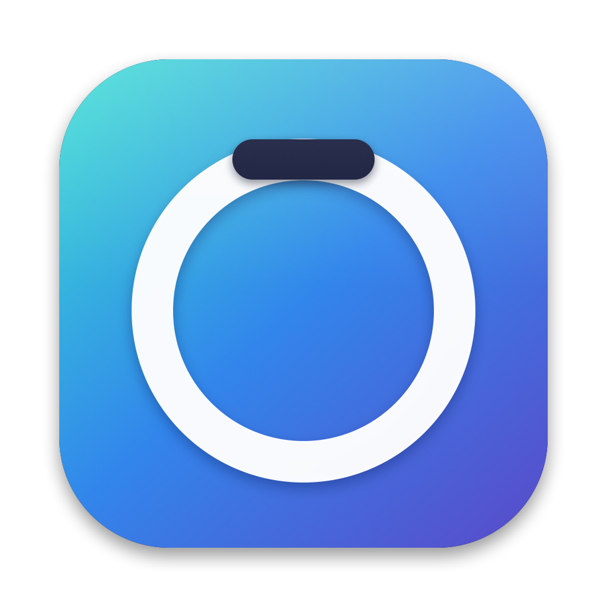
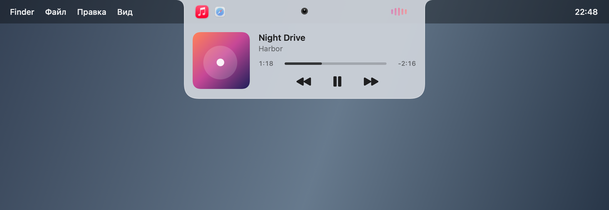
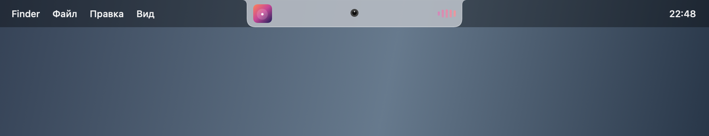
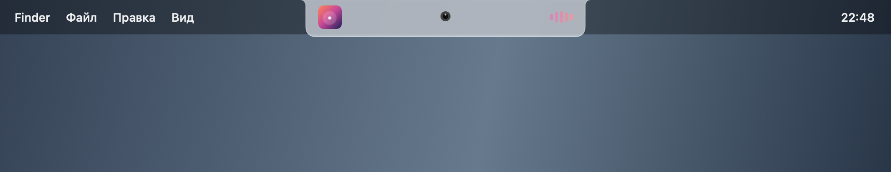

<p align="center"></p>

# Atoll

«Динамический остров» для macOS: плавающая панель у выреза камеры, которая показывает, что играет сейчас, и даёт управлять плеером, не переключаясь в приложение.

<p align="center">
  
</p>

## Что умеет

- **Now Playing из любого приложения.** Яндекс Музыка, YouTube в Chrome, Spotify, Музыка и всё остальное, что публикует системный статус воспроизведения.
- **Несколько источников сразу.** Если звук идёт из двух приложений, их иконки стоят рядом над камерой. Нажатие на иконку переключает виджет на этот источник, повторное открывает приложение. Play на выбранном источнике ставит остальные на паузу.
- **Свёрнутый вид как в Dock.** Миниатюра обложки и эквалайзер по бокам камеры, сверху стекло Liquid Glass.
- **Живой эквалайзер.** Реагирует на реальный системный звук (Core Audio process tap и FFT).
- **Органичная анимация.** Миниатюра обложки сползает вниз и вырастает до полного размера вместе с островом, а иконка приложения выезжает из-за камеры.
- **Управление.** Пауза и воспроизведение, треки вперёд и назад, перемотка по таймлайну.

<p align="center">
  
  
</p>

## Требования

- macOS 14+ (Apple Silicon). Liquid Glass включается на macOS 26, на более старых системах используется обычная подложка.
- Xcode Command Line Tools (`xcode-select --install`).

## Сборка и запуск

```sh
./build.sh
open Atoll.app
```

Проект без Xcode и SwiftPM: `build.sh` собирает всё через `swiftc` и `clang`. Если у вас нет сертификата Apple Development, скрипт подпишет приложение ad-hoc; свой сертификат можно передать так: `SIGN_IDENTITY="Apple Development: ..." ./build.sh`. Со стабильной подписью macOS не сбрасывает выданные разрешения при пересборке.

Полезные режимы:

```sh
Atoll.app/Contents/MacOS/Atoll --preview    # с тестовым треком
Atoll.app/Contents/MacOS/Atoll --snapshot   # сохранить скриншоты в ./screenshots и выйти
```

## Разрешения

- **Запись системного звука**: для эквалайзера.
- **Универсальный доступ**: запасной способ читать Яндекс Музыку и управлять ею.
- **Автоматизация** и в Chrome пункт «Вид → Разработчикам → Разрешить JavaScript из событий Apple»: нужны, чтобы возобновить ролик в браузере, пока активный плеер другой.

## Как это работает

С macOS 15.4 приватный MediaRemote отдаёт данные только процессам Apple. Поэтому Atoll обращается к нему через системный `/usr/bin/perl`, который загружает небольшую библиотеку `Helper/adapter.m` и печатает JSON. Так виден список всех клиентов Now Playing с их треками. Система при этом шлёт команды только активному плееру: остальные источники Atoll трогает напрямую (окно Яндекс Музыки, вкладка браузера).

| Файл | Роль |
| --- | --- |
| `Sources/IslandApp.swift` | окно, геометрия под вырез, модель состояния |
| `Sources/IslandView.swift` | SwiftUI-интерфейс и анимации |
| `Sources/NowPlayingService.swift` | источники, выбор, управление |
| `Sources/AudioSpectrum.swift` | захват звука и спектр |
| `Helper/` | мост к MediaRemote |

## Статус

Личный проект. MediaRemote приватный API, поэтому с новыми версиями macOS что-то может сломаться.

## Безопасность

- Приложение не слушает сеть и не принимает входящих соединений. Единственный исходящий запрос: обложка Яндекс Музыки с `music.yandex.ru` по https, адрес картинки принимается только на доменах Яндекса.
- Данные о треках не пишутся на диск. Диагностика выключена и включается флагом командной строки или `ATOLL_DEBUG=1`, лог лежит в `~/Library/Logs/Atoll` с правами `700`.
- Приложение не нотаризовано. Подпись есть, но Apple её не проверяла: собирайте из исходников, если не доверяете готовому архиву.
- Используется приватный API MediaRemote: он может измениться в любой версии macOS.
